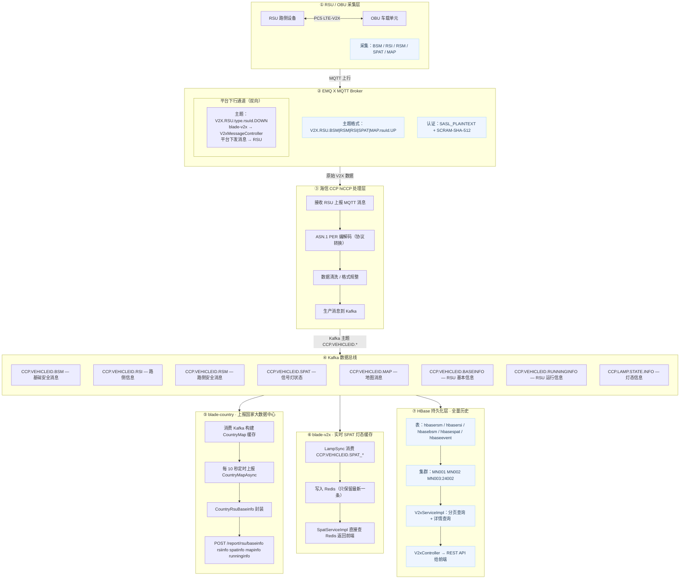

# V2X数据流转

## 概述

​ 在我们的云控基础平台的原始项目当中--SpringBlade,他们使用的框架是SpringBlade这个框架,关于这个所有微服务当中的blade-v2x服务主要的作用是平台和设备之间的通信.

​ OBU车端设备,RSU路端设备,他们采集数据,然后将所有的二进制数据全部推送到我们的HBase数据库当.

## 数据流转

### 上行历史消息查询


flowchart LR
RSU[RSU 设备] -->|上行消息| CCP[CCP 采集平台 外部系统]
CCP -->|写入| HB[(HBase hbasebsm/hbasersm/ hbasersi/hbasespat)]
UI[前端历史查询] -->|GET /v2x/getBsmListPage 等| VC[V2xController]
VC --> VS[V2xServiceImpl]
VS -->|Scan + Filter| HB
VS -.->|vid 换车牌号| SQL[(MySQL dm_vid_vehicle)]
VS -->|返回分页结果| UI


### 下行消息下发


flowchart LR
A[前端/第三方系统] -->|POST /v2x/json/emit| B[V2xMessageController]
B --> C{v2xType 分发}
C -->|0 BSM| D[BsmConvert.jsonToBsm]
C -->|1 MAP| E[MapConvert.jsonToMap]
C -->|2 RSM| F[RsmConvert.jsonToRsm]
C -->|3 SPAT| G[SpatConvert.jsonToSpat]
C -->|4 RSI| H[RsiConvert.jsonToRsi]
D & E & F & G & H --> I[per_encode 编码为 ASN.1 字节流]
I --> J[SimpleMqttClient.publish]
J -->|topic: V2X.RSU.TYPE.rsuId.DOWN| K[EMQX Broker]
K --> L[RSU 路侧设备]
L -->|PC5/C-V2X 广播| M[OBU 车载单元]


### CCP采集系统

### Redis在当中的作用

​ 在我们的SPAT的数据(也就是我们的路灯数据)当中,我们要实时显示的时候,不可能依旧从我们的hbase当中读取,因为hbase读取的数据效率降低,所以,我们在传的时候,直接把最新的给我们的redis,就是只保存了最新数据.我们的hbase依旧保存所有相关的数据.
